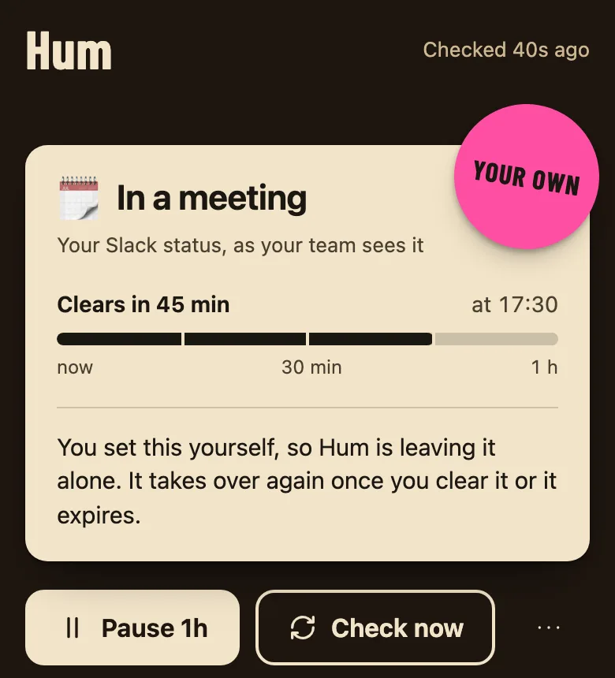
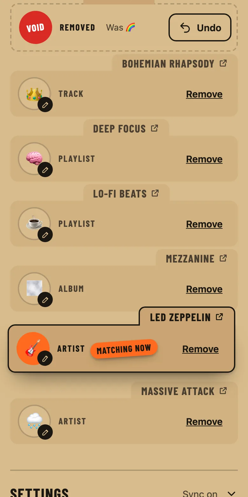
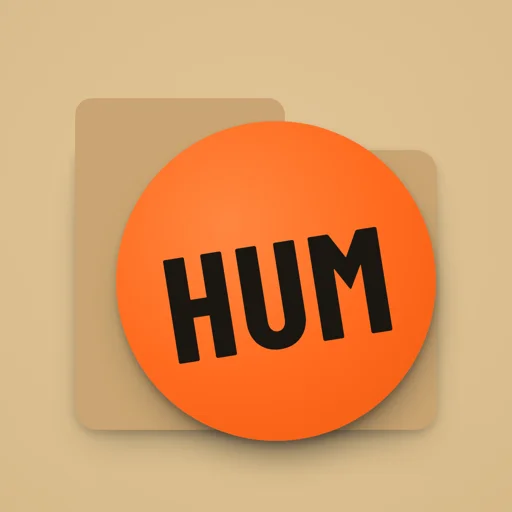

I always have music on while I work, and I've always liked the little "now playing" status some people have in Slack. The catch is that I'd never keep it up to date by hand. So on a Saturday evening I opened a terminal and started [Claude Code](https://claude.com/claude-code). I pointed it at a one-page spec I'd brainstormed earlier and asked it to help me build the thing.

By Sunday evening I had **Hum**. It checks Spotify every minute and sets my Slack status to `Song - Artist`, with an emoji I pick per playlist or artist, and a 🔁 badge when I have something on repeat. It has an admin page and runs on Cloudflare's free plan. It deploys from a Git server on my NAS, and it works across more than one Slack workspace.

This post is the honest version of how that went: what the agent did well, where it went wrong, and where we both hit a wall.

> **Key takeaways**
>
> - The most valuable hour came **before any code**: six AI agents fact-checked my spec and found real mistakes, including one that would have quietly broken the app after six months.
> - My job was making decisions (scope, trade-offs, what to cut). The agent's job was everything else, including the boring bits I'd normally skip.
> - Having **one agent review another** worked better than either alone. An independent design reviewer sent the redesign back twice, and both times it was right.
> - The hard limits weren't technical. They were Spotify's developer rules and how Slack lets apps into a workspace.

<figure>

<svg viewBox="0 0 720 384" xmlns="http://www.w3.org/2000/svg" role="img" aria-labelledby="hj-title hj-desc" class="hj" style="width:100%;min-width:560px;height:auto;display:block">
  <title id="hj-title">The weekend at a glance</title>
  <desc id="hj-desc">Hum went from a one-page spec through a six-agent fact-check, a Spotify-only build and a 22 out of 40 design critique to a redesign that an independent reviewer sent back twice, eight fixes and then two regressions, before it shipped with a DESIGN.md.</desc>
  <defs><marker id="hj-arrow" viewBox="0 0 10 10" refX="9" refY="5" markerWidth="7" markerHeight="7" orient="auto-start-reverse"><path d="M0 0L10 5L0 10z" class="hj-arrowhead"/></marker></defs>
  
  <path d="M168 100 H198" class="hj-wire" marker-end="url(#hj-arrow)"/>
  <path d="M344 100 H374" class="hj-wire" marker-end="url(#hj-arrow)"/>
  <path d="M520 100 H550" class="hj-wire" marker-end="url(#hj-arrow)"/>
  <path d="M624 144 V218" class="hj-wire" marker-end="url(#hj-arrow)"/>
  <path d="M552 246 H434" class="hj-wire" marker-end="url(#hj-arrow)"/>
  <path d="M432 278 H550" class="hj-wire hj-dash" marker-end="url(#hj-arrow)"/>
  <path d="M288 262 H170" class="hj-wire" marker-end="url(#hj-arrow)"/>
  <rect x="456" y="225" width="72" height="13" rx="2" class="hj-mask"/>
  <text x="492" y="234" text-anchor="middle" class="hj-label">SCREENSHOTS</text>
  <rect x="450" y="289" width="84" height="13" rx="2" class="hj-mask"/>
  <text x="492" y="298" text-anchor="middle" class="hj-label">FIX 8, THEN 2</text>
  <rect x="211" y="243" width="34" height="13" rx="2" class="hj-mask"/>
  <text x="228" y="252" text-anchor="middle" class="hj-label">SHIP</text>
  <rect x="28" y="60" width="144" height="88" rx="10" class="hj-shadow hj-shadow-cf"/>
  <rect x="24" y="56" width="144" height="88" rx="10" class="hj-cf hj-node"/>
  <rect x="36" y="68" width="57" height="14" rx="2" class="hj-tag"/>
  <text x="64.5" y="78" text-anchor="middle" class="hj-tagtext">SATURDAY</text>
  <text x="36" y="102" class="hj-name">Spec</text>
  <text x="36" y="118" class="hj-sub">one page, brainstormed</text>
  <text x="36" y="132" class="hj-sub">in an earlier session</text>
  <rect x="204" y="60" width="144" height="88" rx="10" class="hj-shadow hj-shadow-cf"/>
  <rect x="200" y="56" width="144" height="88" rx="10" class="hj-cf hj-node"/>
  <rect x="212" y="68" width="40" height="14" rx="2" class="hj-tag"/>
  <text x="232" y="78" text-anchor="middle" class="hj-tagtext">CHECK</text>
  <rect x="292" y="68" width="40" height="14" rx="2" class="hj-focaltag"/>
  <text x="312" y="78" text-anchor="middle" class="hj-focaltext">FIRST</text>
  <text x="212" y="102" class="hj-name">Agent panel</text>
  <text x="212" y="118" class="hj-sub">6 agents, every</text>
  <text x="212" y="132" class="hj-sub">verdict sourced</text>
  <rect x="380" y="60" width="144" height="88" rx="10" class="hj-shadow hj-shadow-cf"/>
  <rect x="376" y="56" width="144" height="88" rx="10" class="hj-cf hj-node"/>
  <rect x="388" y="68" width="40" height="14" rx="2" class="hj-tag"/>
  <text x="408" y="78" text-anchor="middle" class="hj-tagtext">BUILD</text>
  <text x="388" y="102" class="hj-name">Spotify-only v1</text>
  <text x="388" y="118" class="hj-sub">Worker, Durable Object,</text>
  <text x="388" y="132" class="hj-sub">CI on my NAS</text>
  <rect x="556" y="60" width="144" height="88" rx="10" class="hj-shadow hj-shadow-cf"/>
  <rect x="552" y="56" width="144" height="88" rx="10" class="hj-cf hj-node"/>
  <rect x="564" y="68" width="57" height="14" rx="2" class="hj-tag"/>
  <text x="592.5" y="78" text-anchor="middle" class="hj-tagtext">CRITIQUE</text>
  <text x="564" y="102" class="hj-name">Scored 22/40</text>
  <text x="564" y="118" class="hj-sub">generic page,</text>
  <text x="564" y="132" class="hj-sub">and my button bug</text>
  <rect x="556" y="224" width="144" height="88" rx="10" class="hj-shadow hj-shadow-cf"/>
  <rect x="552" y="220" width="144" height="88" rx="10" class="hj-cf hj-node"/>
  <rect x="564" y="232" width="57" height="14" rx="2" class="hj-tag"/>
  <text x="592.5" y="242" text-anchor="middle" class="hj-tagtext">REDESIGN</text>
  <text x="564" y="266" class="hj-name">Crate dividers</text>
  <text x="564" y="282" class="hj-sub">direction picked</text>
  <text x="564" y="296" class="hj-sub">by a die roll</text>
  <rect x="292" y="224" width="144" height="88" rx="10" class="hj-shadow hj-shadow-cf"/>
  <rect x="288" y="220" width="144" height="88" rx="10" class="hj-cf hj-node"/>
  <rect x="300" y="232" width="46" height="14" rx="2" class="hj-tag"/>
  <text x="323" y="242" text-anchor="middle" class="hj-tagtext">REVIEW</text>
  <rect x="374" y="232" width="46" height="14" rx="2" class="hj-focaltag"/>
  <text x="397" y="242" text-anchor="middle" class="hj-focaltext">SECOND</text>
  <text x="300" y="266" class="hj-name">Fresh reviewer</text>
  <text x="300" y="282" class="hj-sub">no build history,</text>
  <text x="300" y="296" class="hj-sub">only the evidence</text>
  <rect x="28" y="224" width="144" height="88" rx="10" class="hj-shadow hj-shadow-done"/>
  <rect x="24" y="220" width="144" height="88" rx="10" class="hj-done hj-node"/>
  <rect x="36" y="232" width="34" height="14" rx="2" class="hj-tag"/>
  <text x="53" y="242" text-anchor="middle" class="hj-tagtext">DONE</text>
  <text x="36" y="266" class="hj-name">Shipped</text>
  <text x="36" y="282" class="hj-sub">plus DESIGN.md</text>
  <text x="36" y="296" class="hj-sub">from the build</text>
  <line x1="24" y1="344" x2="696" y2="344" class="hj-rule"/>
  <text x="24" y="372" class="hj-eyebrow">LEGEND</text>
  <rect x="104" y="360" width="16" height="16" rx="3" class="hj-node" style="stroke-width:1.5;fill:var(--yellow)"/>
  <text x="128" y="372" class="hj-legend">Agent-run step</text>
  <rect x="239" y="363" width="16" height="10" rx="2" class="hj-focaltag"/>
  <text x="263" y="372" class="hj-legend">Independent check</text>
  <line x1="392" y1="368" x2="408" y2="368" class="hj-wire hj-dash"/>
  <text x="416" y="372" class="hj-legend">Fix round</text>
  <rect x="496" y="360" width="16" height="16" rx="3" class="hj-node" style="stroke-width:1.5;fill:var(--green)"/>
  <text x="520" y="372" class="hj-legend">Shipped</text>
</svg>

  <figcaption style="font-size:var(--text-sm);color:var(--fg-muted);text-align:center;margin-top:0.5rem">Two independent checks did most of the quality work: the agent panel before any code, and a reviewer with no build history after it.</figcaption>
</figure>

## It started as a spec, not code

I'd done the brainstorming in an earlier session: a single-user app, a [Cloudflare Worker](https://developers.cloudflare.com/workers/) on a once-a-minute timer, Spotify and Google Calendar as inputs, Slack status as the output. The spec ended with a list of unchecked assumptions, which is exactly where things get interesting.

The first thing I asked for was small: connect Cloudflare's own MCP server, so the agent could read my Cloudflare account and docs directly instead of guessing. One command, one browser login, done. (If MCP is new to you, I wrote about [how my homelab runs on MCP](/blog/my-homelab-runs-on-mcp/) and [how I hardened that setup](/blog/hardening-my-homelab-mcp-setup/).)

## A panel of agents checked my assumptions 🕵️

Then I asked it to "run a panel of agents to validate all claims and any uncertainties". It spawned six in parallel: one per service (Cloudflare, Slack, Google Calendar and Spotify), plus reviewers for everything else, including an adversarial review of the design itself. Each had to cite its sources for every verdict, which for the four services meant their official docs.

They found things I would otherwise have found the hard way:

| Area | What the agent found | Source |
| --- | --- | --- |
| Slack | Slash commands need a _bot_ token; my spec only had a user token. | [Slack scopes: `commands`](https://docs.slack.dev/reference/scopes/commands) |
| Spotify | Refresh tokens now **expire after six months**, and refreshing doesn't extend them. "Log in once" was really "log in twice a year". | [Refreshing tokens](https://developer.spotify.com/documentation/web-api/tutorials/refreshing-tokens) |
| Spotify | Development-mode apps need the owner on Premium and are capped at **five users**. | [February 2026 migration guide](https://developer.spotify.com/documentation/web-api/tutorials/february-2026-migration-guide) |
| Cloudflare | The plan stored state in Workers KV, which is eventually consistent. A rotated Spotify token could be read back stale and break the login. A [Durable Object](https://developers.cloudflare.com/durable-objects/) is strongly consistent, and free. | [How KV works](https://developers.cloudflare.com/kv/concepts/how-kv-works/) |
| Design review | When a status Hum set expired on its own, Hum would read the empty status as "the user changed it" and lock itself out forever. | Reasoning over the spec |

I also cut the calendar from the first version and built it Spotify-only, tested in my own Slack workspace.

## The build: a Worker, a Durable Object and a timer

The core is deliberately boring. Every minute, a scheduled Worker calls one Durable Object, which:

1. reads my current Slack status;
2. leaves it alone if I set it myself;
3. otherwise asks Spotify what's playing, and sets or clears the status.

<figure>

<svg viewBox="0 0 720 516" xmlns="http://www.w3.org/2000/svg" role="img" aria-labelledby="hm-title hm-desc" class="hm" style="width:100%;min-width:560px;height:auto;display:block">
  <title id="hm-title">How Hum fits together</title>
  <desc id="hm-desc">A once-a-minute Cloudflare timer and an Access-protected admin both reach one Worker, which keeps all state in a single Durable Object, asks Spotify once per check and updates each Slack workspace independently, while pushes to Forgejo on the home NAS deploy the Worker.</desc>
  <defs><marker id="hm-arrow" viewBox="0 0 10 10" refX="9" refY="5" markerWidth="7" markerHeight="7" orient="auto-start-reverse"><path d="M0 0L10 5L0 10z" class="hm-arrowhead"/></marker></defs>
  
  <rect x="24" y="24" width="456" height="292" rx="12" class="hm-zone"/>
  <rect x="36" y="16" width="144" height="16" rx="2" class="hm-mask"/>
  <text x="44" y="27" class="hm-eyebrow">CLOUDFLARE, FREE PLAN</text>
  <rect x="24" y="344" width="456" height="112" rx="12" class="hm-zone"/>
  <rect x="36" y="336" width="65" height="16" rx="2" class="hm-mask"/>
  <text x="44" y="347" class="hm-eyebrow">HOME NAS</text>
  <path d="M184 100 H192 Q200 100 200 108 V152 Q200 160 208 160 H214" class="hm-wire" marker-end="url(#hm-arrow)"/>
  <path d="M184 248 H192 Q200 248 200 240 V192 Q200 184 208 184 H214" class="hm-wire" marker-end="url(#hm-arrow)"/>
  <path d="M320 172 H350" class="hm-wire" marker-end="url(#hm-arrow)"/>
  <path d="M464 152 H488 Q496 152 496 144 V104 Q496 96 504 96 H526" class="hm-wire" marker-end="url(#hm-arrow)"/>
  <path d="M464 196 H488 Q496 196 496 204 V248 Q496 256 504 256 H526" class="hm-wire" marker-end="url(#hm-arrow)"/>
  <path d="M268 372 V210" class="hm-wire" marker-end="url(#hm-arrow)"/>
  <rect x="276" y="324" width="106" height="13" rx="2" class="hm-mask"/>
  <text x="282" y="333" text-anchor="start" class="hm-label">PUSH, THEN DEPLOY</text>
  <rect x="52" y="68" width="136" height="72" rx="10" class="hm-shadow hm-shadow-cf"/>
  <rect x="48" y="64" width="136" height="72" rx="10" class="hm-cf hm-node"/>
  <rect x="60" y="76" width="51" height="14" rx="2" class="hm-tag"/>
  <text x="85.5" y="86" text-anchor="middle" class="hm-tagtext">TRIGGER</text>
  <text x="60" y="110" class="hm-name">Cron</text>
  <text x="60" y="126" class="hm-sub">every minute</text>
  <rect x="52" y="216" width="136" height="72" rx="10" class="hm-shadow hm-shadow-cf"/>
  <rect x="48" y="212" width="136" height="72" rx="10" class="hm-cf hm-node"/>
  <rect x="60" y="224" width="40" height="14" rx="2" class="hm-tag"/>
  <text x="80" y="234" text-anchor="middle" class="hm-tagtext">LOGIN</text>
  <text x="60" y="258" class="hm-name">Access</text>
  <text x="60" y="274" class="hm-sub">you only</text>
  <rect x="220" y="140" width="104" height="72" rx="10" class="hm-shadow hm-shadow-cf"/>
  <rect x="216" y="136" width="104" height="72" rx="10" class="hm-cf hm-node"/>
  <rect x="228" y="148" width="46" height="14" rx="2" class="hm-tag"/>
  <text x="251" y="158" text-anchor="middle" class="hm-tagtext">WORKER</text>
  <text x="228" y="182" class="hm-name">Worker</text>
  <text x="228" y="198" class="hm-sub">timer + admin</text>
  <rect x="356" y="112" width="112" height="128" rx="10" class="hm-shadow hm-shadow-cf"/>
  <rect x="352" y="108" width="112" height="128" rx="10" class="hm-cf hm-node"/>
  <rect x="364" y="120" width="40" height="14" rx="2" class="hm-focaltag"/>
  <text x="384" y="130" text-anchor="middle" class="hm-focaltext">STATE</text>
  <text x="364" y="154" class="hm-name">State</text>
  <text x="364" y="170" class="hm-sub">one Durable</text>
  <text x="364" y="184" class="hm-sub">Object holds</text>
  <text x="364" y="198" class="hm-sub">workspaces,</text>
  <text x="364" y="212" class="hm-sub">rules, repeats</text>
  <rect x="544" y="196" width="152" height="88" rx="10" class="hm-shadow hm-shadow-ext"/>
  <rect x="540" y="200" width="152" height="88" rx="10" class="hm-ext hm-node"/>
  <rect x="534" y="206" width="152" height="88" rx="10" class="hm-ext hm-node"/>
  <rect x="532" y="216" width="152" height="88" rx="10" class="hm-shadow hm-shadow-ext"/>
  <rect x="528" y="212" width="152" height="88" rx="10" class="hm-ext hm-node"/>
  <rect x="540" y="224" width="79" height="14" rx="2" class="hm-tag"/>
  <text x="579.5" y="234" text-anchor="middle" class="hm-tagtext">N WORKSPACES</text>
  <text x="540" y="258" class="hm-name">Slack</text>
  <text x="540" y="274" class="hm-sub">each decided alone;</text>
  <text x="540" y="288" class="hm-sub">your own status wins</text>
  <rect x="532" y="64" width="152" height="72" rx="10" class="hm-shadow hm-shadow-ext"/>
  <rect x="528" y="60" width="152" height="72" rx="10" class="hm-ext hm-node"/>
  <rect x="540" y="72" width="40" height="14" rx="2" class="hm-tag"/>
  <text x="560" y="82" text-anchor="middle" class="hm-tagtext">MUSIC</text>
  <text x="540" y="106" class="hm-name">Spotify</text>
  <text x="540" y="122" class="hm-sub">asked once per check</text>
  <rect x="192" y="376" width="160" height="72" rx="10" class="hm-shadow hm-shadow-lab"/>
  <rect x="188" y="372" width="160" height="72" rx="10" class="hm-lab hm-node"/>
  <rect x="200" y="384" width="23" height="14" rx="2" class="hm-tag"/>
  <text x="211.5" y="394" text-anchor="middle" class="hm-tagtext">CI</text>
  <text x="200" y="418" class="hm-name">Forgejo</text>
  <text x="200" y="434" class="hm-sub">runner deploys on push</text>
  <line x1="24" y1="476" x2="696" y2="476" class="hm-rule"/>
  <text x="24" y="504" class="hm-eyebrow">LEGEND</text>
  <rect x="104" y="492" width="16" height="16" rx="3" class="hm-node" style="stroke-width:1.5;fill:var(--yellow)"/>
  <text x="128" y="504" class="hm-legend">Cloudflare</text>
  <rect x="214" y="492" width="16" height="16" rx="3" class="hm-node" style="stroke-width:1.5;fill:var(--cyan)"/>
  <text x="238" y="504" class="hm-legend">Outside services</text>
  <rect x="361" y="492" width="16" height="16" rx="3" class="hm-node" style="stroke-width:1.5;fill:var(--pink)"/>
  <text x="385" y="504" class="hm-legend">My homelab</text>
  <rect x="471" y="495" width="16" height="10" rx="2" class="hm-focaltag"/>
  <text x="495" y="504" class="hm-legend">The one store</text>
</svg>

  <figcaption style="font-size:var(--text-sm);color:var(--fg-muted);text-align:center;margin-top:0.5rem">Everything Hum remembers lives in one Durable Object, so a check and an admin edit can never race.</figcaption>
</figure>

The rule that makes it feel polite is that **Hum only ever touches a status it set itself**. If I write "In a meeting", Hum backs off until that's cleared or expires. The decision logic is a pure function with no network calls, so it's easy to test, and the test count went from 21 on day one to 114 by the end.

_When I set my own status, Hum says so and steps back._

A couple of first-time gotchas came up, and the agent handled each one in stride. Cloudflare wouldn't deploy anything until my account had a `workers.dev` subdomain, even though Hum has no public URL, so it created one through the API. Testing locally meant running ticks by hand against my real Slack, which is a great way to find out your status logic works while everyone else in the workspace watches.

## Shipping from my own NAS 🏠

I wanted the code on my self-hosted [Forgejo](https://forgejo.org), the same NAS that runs [my Usenet setup](/blog/usenet-setup-2026-eastern-europe/), with every push deploying automatically. This part had the most "oh, of course" moments:

- Forgejo had **push-to-create disabled**, so the agent created the repo through the API with the credentials git already had.
- The CI job sat waiting forever. The cause turned out to be that my runner was **registered to one specific repo**, not my user. The agent found it by reading the Forgejo database (read-only), re-registered the runner for all my repos, and kept a backup of the old config.
- The first real deploy failed because a package installed locally with relaxed peer dependencies didn't match what CI's stricter `npm ci` expected. A one-line `.npmrc` fixed it.

And one that was entirely mine: when storing the Cloudflare API token as a CI secret, I pasted the token where the secret's *name* goes. The agent deleted it and suggested I roll the token, plus a version of the command that reads straight from the clipboard so the value never lands in the terminal. Lesson learned. 😅

## Fun features, then an admin page

With the plumbing done, I asked "what fun things can we do?" and picked two from the list:

- **Emoji by context:** 🧠 for my focus playlist, 🎸 for Led Zeppelin. The most specific rule wins (track, then playlist, then album, then artist).
- **An "on repeat" badge:** play the same song three times and the status becomes `🔁 x3 Kashmir - Led Zeppelin`.

Editing those in a config file got old fast, so we built an admin page on the same Worker using [Hono](https://hono.dev). It sits behind [Cloudflare Access](https://developers.cloudflare.com/cloudflare-one/policies/access/), and the Worker *also* checks Access's signed token on every request, so a misconfiguration fails closed instead of open. Spotify search, "make a rule for what's playing" and an emoji picker that outputs Slack codes all came out of quick "could we…" requests.

## Then I asked for a design critique

The admin worked, but it looked like what it was: a default CSS framework with forms on it. I ran [Impeccable](https://impeccable.style)'s critique, which uses two independent agents (a design review and a mechanical detector) that can't see each other's notes. It scored the page **22 out of 40**.

The best finding was the agent's own bug. I'd loaded the "classless" version of the CSS framework but styled buttons with classes only the full version understands. Every button on the page, including **Remove**, was the same loud blue.

I chose to redesign rather than patch. Impeccable's process is opinionated: it brainstorms seven visual directions from the subject's world, then a die roll picks which one gets built, to stop every project landing on the same default look. Mine landed on **record-store crate dividers**. My status is the white card at the front of the crate, and my emoji rules are the kraft dividers behind it. The one matching the current song lifts out of the crate.

_Rules as crate dividers. Removing one leaves a VOID card with Undo instead of making it vanish._

What impressed me most was the review loop. After the build, a separate reviewer agent, with no access to the build conversation, judged the screenshots against the written design contract. It came back with **eight material fixes**. After those, it found **two regressions my fixes had introduced** (tabs jumping position when a rule was removed, and a link with no visible cue on touch screens). Only the third round got a "ship". I wouldn't have caught either regression by eye.

## Naming it, and giving it an icon

The repo was called `slack-status-sync`, which is accurate and joyless. I asked for something fun, rejected the first two batches ("something a bit more original"), and picked **Hum**: a status is just a public hum, the song in your head that the people around you can see.

_The icon is plain HTML and CSS, rendered to a PNG with headless Chrome._

## More than one Slack workspace

Slack tokens belong to one workspace each, so supporting several meant turning Hum into a properly distributed Slack app with an **Add workspace** button, built on [Slack's OAuth flow](https://docs.slack.dev/authentication/installing-with-oauth). Each workspace's token is encrypted at rest. Every minute Hum asks Spotify once, then updates each workspace independently, so a manual status or an outage in one never affects another.

Each workspace also gets a share level: the full song, a vague "Listening to music", or nothing at all. I asked whether different emails for work and personal Slack would be a problem. They aren't: each workspace is linked separately, and Hum never matches accounts by email, which would be a security hole anyway.

## Where it stopped 🧱

The first real "Add workspace" attempt on a second workspace got Slack's generic "There's been a bit of a hitch" error. The agent checked the request (client ID, redirect and scopes were all correct) and pointed at the real cause: workspace admins can restrict which apps members may install, and this workspace did.

I asked whether listing Hum on Slack's Marketplace would help. The agent checked [Slack's current Marketplace guidelines](https://docs.slack.dev/slack-marketplace/slack-marketplace-app-guidelines-and-requirements). You need **at least 10 active workspaces and 10 weekly active users** before you can even submit. On top of that come a public landing page, support and privacy pages, and a review. Invite-only apps are likely to be turned down. So Hum stays unlisted, and getting it into a locked-down workspace means asking its admins first.

Sharing it with family and friends has its own wall: Spotify's five-user cap for apps in development. The workarounds (each friend registering their own Spotify app, or reading from Last.fm instead) all trade convenience for scale, so that's a decision for another weekend.

## Where it stumbled 🙈

It wasn't flawless, and the misses are the useful part:

- **It shipped a CSS bug it later caught in review.** The identical-blue-buttons problem was its own doing. The critique found it; I didn't.
- **Its first fix batch broke two things.** The second review round caught both, which is the argument for independent review rather than self-checking.
- **Environment surprises cost a few retries.** Headless Chrome on macOS won't make a window narrower than about 500px, so the first "phone" screenshots were lying. It switched to driving Chrome through its DevTools protocol for true 390px captures.
- **It occasionally assumed instead of asking.** It picked my time zone and the wording for the vague share level without checking. Both were right, but I'd rather it had asked first. To its credit, it listed both choices afterwards.

## What I'd tell you

If you've used an AI agent for code before, the coding part won't surprise you. What surprised me was everything around it:

1. **Make it check its own homework before building.** The agent panel earned its keep in the first hour, and the bugs it prevented would have surfaced months later.
2. **Keep the decisions.** Scope, what to cut, which design direction, what to name it: those stayed mine, and the work was better for it.
3. **Use a second agent as the reviewer.** A fresh context with only the evidence catches what the builder talks itself out of.
4. **Expect the real limits to be rules, not code.** Every wall Hum hit was a terms-of-service or permissions question.

Hum is humming along on my personal Slack right now. If you want the bigger picture of how I work with agents, start with [how I rebuilt this site with one in a day](/blog/rebuilding-my-site-with-an-ai-agent/).
